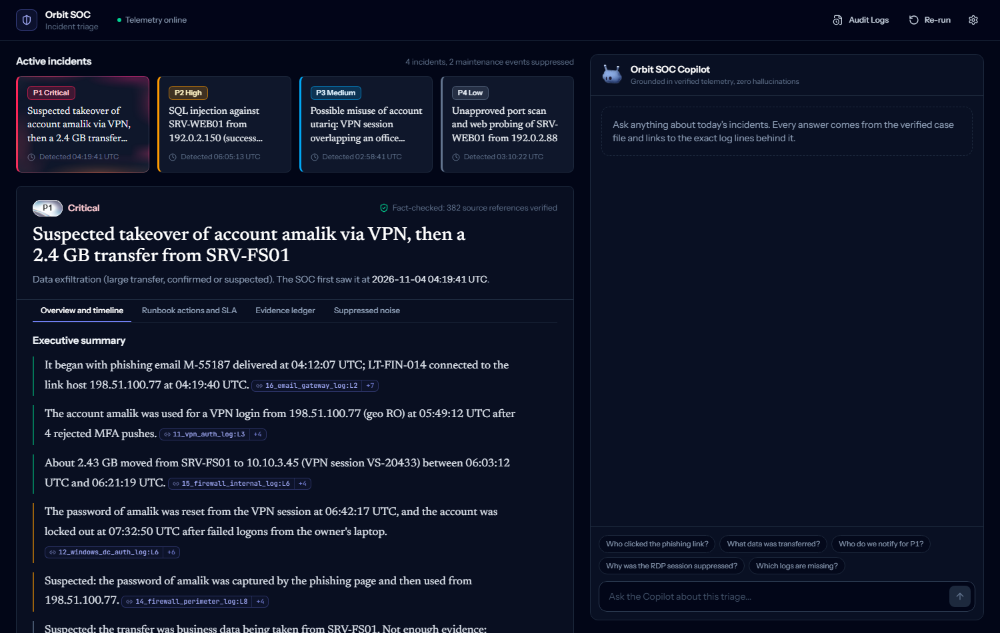
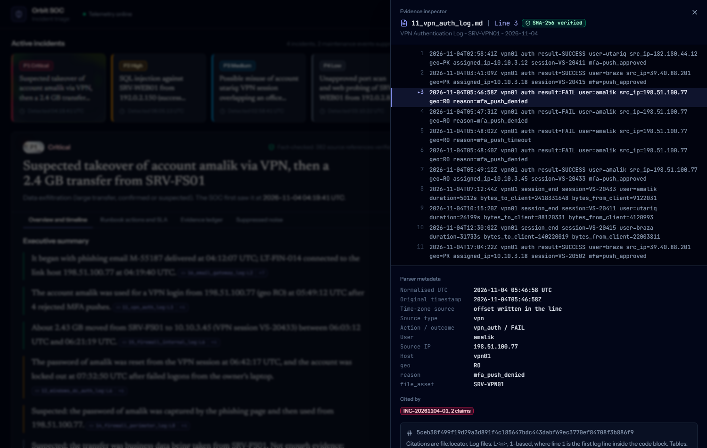
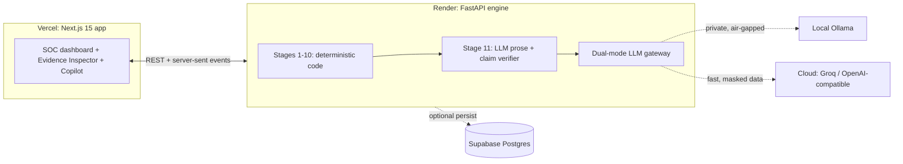
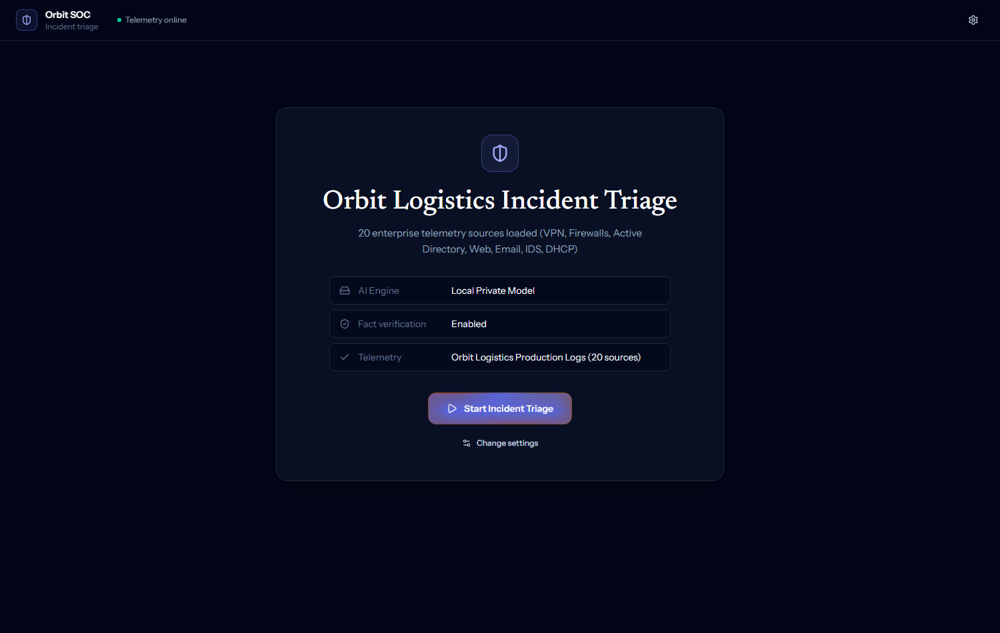
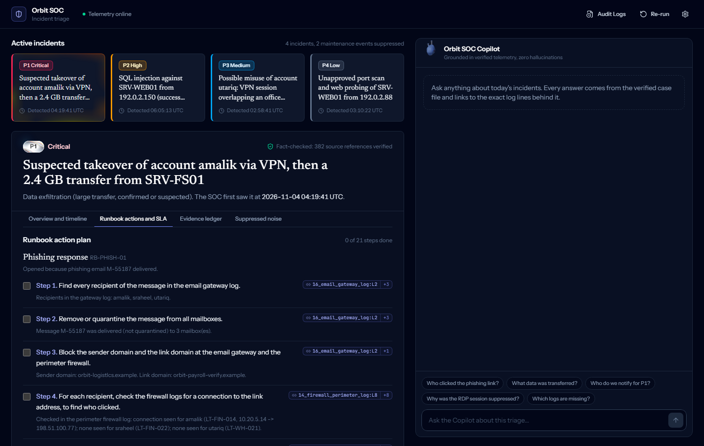

## NOTE: I can vouch on my backend it will be the best of all. But the look of our system is not that appealing. I can vouch it can pass all the tests and edge cases. Also we have used Local Modal not a Cloud LLM considering the secuirty concerns of  company. So I would request test our system on backend rather than the visual appeal of the system


# Orbit SOC Triage: Security Incident Triage Assistant

**Tech Fusion '26 AI Hackathon, Problem C (Orbit Logistics)**

An incident triage assistant that reads 20 raw files (VPN, firewall, domain controller, web, email, IDS and DHCP logs plus the company's rules, asset inventory, severity matrix, runbooks and change calendar) and produces a verified case file. It separates real incidents from approved maintenance noise, builds an evidence ledger with a `file:line` citation behind every statement, picks the actions from the approved runbooks, and works out who must be told and by when.

> **The LLM writes language. Code establishes facts.**
>
> Stages 1 to 10 are plain Python. They parse, normalise times, correlate, detect, filter, score and cite. A language model only appears in stage 11, to phrase a summary from claims that code has already verified, and a second piece of code (the claim verifier) throws the text away if any sentence is not grounded in the cited log lines.



## Contents

1. [What it does with the Orbit data pack](#what-it-does-with-the-orbit-data-pack)
2. [Key features](#key-features)
3. [Architecture](#architecture)
4. [The 11-stage pipeline](#the-11-stage-pipeline)
5. [Anti-hallucination: the claim verifier](#anti-hallucination-the-claim-verifier)
6. [Security model](#security-model)
7. [The web app](#the-web-app)
8. [Quick start](#quick-start)
9. [Configuration](#configuration)
10. [API reference](#api-reference)
11. [Tests and the edge-case pack](#tests-and-the-edge-case-pack)
12. [Database (Supabase)](#database-supabase)
13. [Deployment](#deployment)
14. [Repository layout](#repository-layout)
15. [Design decisions and heuristics](#design-decisions-and-heuristics)
16. [Known limitations](#known-limitations)
17. [Data pack notes (from the organizers)](#data-pack-notes-from-the-organizers)

---

## What it does with the Orbit data pack

Running the pipeline on `security_triage_data/` (all 82 inputs parse, none are quarantined: 74 log lines plus 8 IDS alert rows) gives four separate incidents, scored on their own as security rule 4.3 requires, and two groups of activity closed as approved maintenance.

| Incident | Severity | What the logs show |
|---|---|---|
| Suspected takeover of account `amalik` via VPN, then a 2.4 GB transfer from `SRV-FS01` | **P1** | A phishing email with a look-alike sender, the link host contacted from `LT-FIN-014`, 4 rejected MFA pushes then an approved VPN login from Romania, 2,426,727,912 bytes moved from `SRV-FS01`, a password reset from the VPN session, then the real user locked out |
| SQL injection against `SRV-WEB01` from 192.0.2.150 | **P2** | 5 injection requests from `sqlmap`; four answered with HTTP 500 and one with a 48,213-byte HTTP 200, so success is suspected |
| Possible misuse of account `utariq` (rule 6.2) | **P3**, flagged *suspected only* | A VPN session was open while the same account logged on in the office |
| Unapproved port scan and web probing from 192.0.2.88 | **P4** | 5 denied ports, 1 allowed, then probes for `/admin`, `/phpmyadmin/`, `/.env` that all returned 404 |

**Closed as harmless (never deleted):** `CHG-2026-1104-02` (the monthly vulnerability scan by `SCAN01`) and `CHG-2026-1104-03` (the `braza` remote-desktop patching session). Each passes all five checks (approval, time window, asset scope, actor, activity type) and is listed with its change ID, the matching IDS alerts (ALT-9006, ALT-9007) and the suppressed log lines.

Things the report gets right that a quick read of the logs gets wrong:

- **Time zones.** The internal firewall logs in local PKT with no zone written, and logs when a session *closes*. The 2.4 GB transfer closed at `11:21:19` local = `06:21:19 UTC` and started at `06:03:12 UTC` (close minus the 1,087 s duration).
- **"Reached" means a confirmed login or session** (rule 4.1). `SRV-DC01` (Critical) only saw Kerberos traffic from the attacker's session, with no logon on the server, so it does not drive severity. The report shows the result would be P1 for that part if it were counted.
- **A transfer is not a theft** (rule 2.4). Which files were read is listed under *Not enough evidence in the logs*, because the file-access audit agent is not installed on `SRV-FS01`.
- **The firewall reboot hides the attacker.** The internal firewall has no logs from 06:32:00 to 07:28:59 UTC, while the attacker's VPN session stayed open until 07:12:44 UTC. The report says so instead of claiming "nothing happened".
- **SLA clock.** The escalation sheet starts the clock when the SOC first sees the incident. The pipeline defines that as the first linked IDS alert (ALT-9002 at 04:19:41 UTC), states the definition, and gives the CISO deadline as 04:34:41 UTC.

## Key features

### 1. Noise versus incident separation
A five-condition match engine (`backend/app/pipeline/noise.py`) suppresses activity only if **all** of these hold for each event:

| Check | Meaning |
|---|---|
| Approval | The calendar entry is approved or completed (not postponed, cancelled or requested) |
| Time window | The event (including a session's derived start and end) is inside the window, converted from the calendar's PKT to UTC |
| Asset scope | The target is a listed host or inside a listed CIDR range |
| Actor | The source address is resolved *at the time of the event* and matches the named person or tool |
| Activity type | The kind of activity fits the change description |

Failures are handled, not ignored: an approved scanner outside its window, or against an out-of-scope host, stays escalated; activity that only partly fits is split; an unfamiliar actor inside a maintenance window is kept and flagged `RESIDUAL_ANOMALY_DURING_MAINTENANCE`.

### 2. Grounded line-level citations and the Evidence Inspector
Every event, claim, action and contact carries `file:locator` citations. Log lines use `L<n>`, where line 1 is the first line **inside** the code block. Tables use the row ID (alert ID, asset tag, change ID, username), runbooks use `S<n>`, rules use `R<n.n>`. Clicking any citation pill opens the **Evidence Inspector** drawer, which fetches the source, scrolls to the exact line, highlights it with surrounding context, shows the parser's metadata and checks the file's SHA-256.



### 3. Anti-hallucination claim verifier
Code that checks every cited line exists, that every IP, user and host in a sentence appears in the lines it cites, that no IP is invented, and that strong words (stolen, leaked, breached, exfiltrated, compromised) only appear on confirmed statements. See [below](#anti-hallucination-the-claim-verifier).

### 4. Prompt-injection layer
Logs are attacker-controlled. Injection text in a User-Agent, URL or email header is detected (URL-decoded first so `%20` obfuscation does not hide it), the line is quarantined from any model, and it is reported as an attack finding. Evidence only ever reaches a model inside an `<untrusted_evidence_data>` boundary. See [Security model](#security-model).

### 5. Three-tier evidence ledger
Every claim is `Confirmed` (a log line or table row states it), `Suspected` (fits a pattern but needs a guess, and the guess is written out) or `Not enough evidence in the logs` (silent or missing source). Things that logs alone can never confirm (who the attacker is, what data was read, whether a password was typed into a page) are created as suspected or not-enough-evidence by construction.

### 6. Runbook-constrained actions and escalation
Recommended actions can only be steps that exist in the runbook files, each with its runbook ID and step number. The code adds what the evidence already says about a step (for example, the real user's phone number for step 1 of `RB-CRED-02`), never a new action. People to inform come only from the escalation sheet, with deadlines computed from the SOC clock and a live countdown in the UI.

### 7. Other pipeline features
Time-aware entity resolution (DHCP leases and VPN sessions valid only for a time window, ambiguity kept rather than merged), cross-system clock-skew check, coverage and gap analysis, quarantine of any line no parser understands (never dropped), log-shipping duplicate handling, a tamper-evident SHA-256 chain of custody, and a question-answering endpoint that answers from the structured store rather than from raw logs.

## Architecture



| Layer | Technology |
|---|---|
| Backend | Python 3.11+, FastAPI, Pydantic v2, NetworkX, Uvicorn, httpx |
| Frontend | Next.js 15 (App Router), React 19, TypeScript, Tailwind CSS 4, Radix UI primitives (shadcn/ui style), lucide-react |
| UI effects | `border-beam`, `thinking-orbs`, `bot-avatars`, `metal-fx` (from the libraries.dev skill) |
| LLM | Ollama (local) with a fall-through to any OpenAI-compatible endpoint (Groq by default) |
| Database | Supabase (PostgreSQL), schema in `backend/supabase/migrations/` |
| Integrity | SHA-256 over raw files, parsed events and the case file |

## The 11-stage pipeline

Stages 1 to 10 are deterministic code. Their output is the JSON case file.

| # | Stage | What it does | Code |
|---|---|---|---|
| 1 | Ingest and classify | Classifies files by content (not by name) as log, reference or runbook. Handles BOM, CRLF, gzip, repeated table headers. Fixes the line-numbering convention | `pipeline/ingest.py` |
| 2 | Parse and quarantine | One parser per format (VPN, Windows DC, combined web log, firewalls, email, DHCP, IDS table) with content-based format detection and a generic fallback. A line no parser accepts is quarantined with its `file:line`, never dropped | `pipeline/parsers.py` |
| 3 | UTC time normalisation | Reads each source's zone policy from the coverage sheet (file 20), converts everything to UTC while keeping the original text, derives session starts for sources that log at close, compares cross-system pairs for clock skew | `parsers.py`, `timeutil.py`, `run.py` |
| 4 | Temporal entity resolution | A NetworkX graph linking users, hosts, IPs and asset tags. Every edge has `valid_from` and `valid_until` and carries its evidence. Conflicts are kept as `ambiguous` | `pipeline/entities.py` |
| 5 | Detection and clustering | Phishing delivery and click, MFA fatigue, large transfer, SQL injection, port scans, web probing, admin RDP, concurrent logins, prompt injection. IDS alerts are linked to the raw lines that explain them. Findings are clustered by shared *actor* evidence | `pipeline/detectors.py` |
| 6 | Noise filter | The five-check calendar match and the clustering into incidents | `pipeline/noise.py` |
| 7 | Severity | Matrix lookup (incident type x criticality of the most critical asset actually reached), with every step written out | `pipeline/response.py` |
| 8 | Coverage and gaps | Turns the coverage sheet into explicit UTC gaps and lists sources that are not collected | `references.py`, `assemble.py` |
| 9 | Evidence ledger | Builds the confirmed / suspected / not-enough-evidence claims, timeline and affected assets | `pipeline/assemble.py` |
| 10 | Runbooks and escalation | Binds evidence to runbook steps and computes contacts and deadlines | `pipeline/response.py` |
| 11 | Report and verifier | Renders the report (template always works), optionally lets a model write the summary, and verifies every sentence | `report.py`, `llm/`, `verifier.py` |

The orchestrator is `backend/app/pipeline/run.py`. It emits one event per stage, which the UI shows live.

## Anti-hallucination: the claim verifier

`backend/app/pipeline/verifier.py` runs on every report, whoever wrote it.

| Check | Failure means |
|---|---|
| Every cited `file:locator` exists in the ingested evidence | A hallucinated citation |
| Every IP, username and hostname in a sentence appears in the lines that sentence cites (hostnames may match through an alias such as `FS01.orbit.local`) | A grounding mismatch |
| No IP appears that does not exist anywhere in the evidence | An invented address |
| Strong words are only used on `Confirmed` statements | The wording is downgraded and the change is logged |

For model-written prose the rules are stricter: every sentence must end with the claim IDs it used, may only name entities those claims name, may not use numbers the claims do not contain, and must hedge ("suspected", "may", "not shown") when none of the claims it cites are confirmed. On rejection the model gets **one retry** with the verifier's error messages; if that also fails, the deterministic template summary is used. The settings panel has a toggle to turn this gate off (not recommended); the check still runs and is logged.

## Security model

| Threat | Defence | Code |
|---|---|---|
| Prompt injection in log fields | Regex signatures (URL-decoded first), the line is flagged, quarantined from the model, and reported as an attack finding. The model is also told that anything inside the data boundary is data, never instructions | `security/injection.py` |
| Logs reaching the model as instructions | All evidence is placed inside `<untrusted_evidence_data>` tags with payloads removed and the closing tag neutralised | `injection.sandbox()` |
| Sensitive data leaving the perimeter | IPs, usernames, full names, hostnames, emails and domains are replaced by tokens (`USER_1`, `IP_EXT_2`) before **any** model call, local or cloud, and restored in code afterwards | `security/pseudonymize.py` |
| Secrets in logs | Passwords, tokens and keys are redacted before display or prompting | `injection.redact_secrets()` |
| Over-sharing with a model | The model gets verified claims, never raw log lines | `llm/prose.py` |
| Tampering | A SHA-256 digest of raw files, parsed events and the case file (the chain of custody shown in the footer and Audit Logs) | `security/integrity.py` |
| Public access to security data | Supabase row-level security is on for every table with **no** policies, so only the backend's service-role key can read them | migration SQL |

## The web app

The dashboard has four states: a 1.5 second splash while the backend is checked, a launchpad (triage never starts by itself), a running view with a progress card, and the 60:40 triage workspace.

| Area | What it holds |
|---|---|
| Incident cards (top left) | Severity badge, title and detection time. The active card glows (`border-beam`) |
| Incident analysis (left, 60%) | **Overview and timeline:** serif executive summary, an incident ribbon on a true time axis (events, SOC clock start, hatched log gaps), and a phase-grouped attack timeline. **Runbook actions and SLA:** checkable steps and contact cards with live countdowns. **Evidence ledger:** confirmed, suspected, unobserved. **Suppressed noise:** the approved changes with their five checks |
| SOC Copilot (right, 40%) | A full-height chat that answers from the case file, with clickable citation pills and quick prompts |
| Settings (gear icon) | AI model (Local private or Cloud), telemetry dataset (Orbit logs or the edge-case suite), and the anti-hallucination verifier toggle |
| Audit Logs (side sheet) | The full verified report, parsing and time-zone audit, and the processing record with the integrity digest |





The layout works down to phone width (see `docs/screenshots/mobile.png`), respects reduced-motion preferences, and every citation pill is keyboard reachable.

## Quick start

### Prerequisites

- Python 3.11 or newer
- Node.js 20 or newer
- Optional: [Ollama](https://ollama.com) for the local model, a Groq (or other OpenAI-compatible) API key for the cloud model

### 1. Backend

```bash
cd backend
python -m venv .venv

# Windows
.venv\Scripts\pip install -r requirements.txt
# macOS / Linux
# .venv/bin/pip install -r requirements.txt

python scripts/build_edge_pack.py        # builds datasets/edge_cases (planted traps)
python -m pytest -q                      # 38 tests
uvicorn app.main:app --reload --port 8000
```

Interactive API docs are at http://localhost:8000/docs. To run the pipeline without a server:

```bash
python scripts/run_triage.py orbit --report          # stage trace + full markdown reports
python scripts/run_triage.py edge_cases --llm off    # the planted-trap dataset
python scripts/run_triage.py orbit --llm local       # with the local model writing summaries
```

### 2. Frontend

```bash
cd frontend
npm install
cp .env.example .env.local               # NEXT_PUBLIC_API_URL=http://localhost:8000
npm run dev                              # http://localhost:3000
```

For a production build: `npm run build && npm start`.

### 3. Use it

1. Open http://localhost:3000. After the splash you land on the launchpad.
2. Click the gear icon if you want to change the AI model or dataset.
3. Click **Start Incident Triage**. The 11 stages run and the dashboard opens.
4. Click any citation pill to open the Evidence Inspector, or ask the Copilot something such as *"Who do we notify for P1?"*.

### Optional: the local model

```bash
ollama pull llama3.1:8b        # or qwen2.5:7b
```

The gateway picks `llama3.1:8b`, then `qwen2.5:7b`, then any model of those families, then the largest installed text model. Set `OLLAMA_MODEL` to force one.

## Configuration

Backend settings are environment variables (see `backend/.env.example`):

| Variable | Default | Purpose |
|---|---|---|
| `LLM_MODE` | `auto` | `auto` tries Ollama then the cloud endpoint then the template. `local`, `cloud` or `off` force one |
| `OLLAMA_URL` | `http://localhost:11434` | Local Ollama endpoint |
| `OLLAMA_MODEL` | empty | Force a specific local model |
| `LLM_BASE_URL` | `https://api.groq.com/openai/v1` | Any OpenAI-compatible endpoint |
| `LLM_API_KEY` or `GROQ_API_KEY` | empty | Key for that endpoint. Without a key the cloud engine is unavailable |
| `LLM_MODEL` | `llama-3.1-8b-instant` | Cloud model |
| `LLM_FALLBACK_BASE_URL`, `LLM_FALLBACK_API_KEY`, `LLM_FALLBACK_MODEL` | OpenRouter | Second cloud provider, tried if the first fails |
| `LLM_TIMEOUT_S`, `LLM_MAX_RETRIES` | `90`, `2` | Timeout and retries (exponential backoff on 429 and 5xx) |
| `LLM_PSEUDONYMIZE` | `true` | Mask IPs, users and hosts before any model call |
| `SUPABASE_URL`, `SUPABASE_SERVICE_ROLE_KEY` | empty | Enables `POST /api/persist`. Server side only |
| `CORS_ORIGINS` | `*` | Comma-separated allowed origins. Set this in production |
| `DATA_DIR`, `EDGE_PACK_DIR`, `CACHE_DIR` | repo paths | Where the data, edge pack and LLM cache live |

Detection thresholds are in `backend/app/config.py`. The data pack gives no numeric thresholds, so every one is a named heuristic that the report states where it was used.

Frontend: `NEXT_PUBLIC_API_URL` (the backend URL). The chosen engine, dataset and verifier toggle are remembered in the browser's local storage; the app works the same without it.

### LLM gateway behaviour

| Mode | Behaviour |
|---|---|
| Local | Ollama only. Fully air-gapped |
| Cloud | The OpenAI-compatible endpoint, then the fallback provider |
| Off, or nothing reachable | The deterministic template report. The demo never fails |

Answers are cached on disk by a hash of the input, so repeating a run is fast. Ollama cannot run on a CPU-only web service, which is why the cloud mode exists for deployment.

## API reference

| Method and path | Purpose |
|---|---|
| `GET /api/health` | Service status, which LLM engines are available, datasets present, whether Supabase is configured |
| `GET /api/datasets` | Available datasets |
| `GET /api/triage/stream?dataset=&llm=&verify=` | Server-sent events: one `running` and one `done` event per stage, then `complete` |
| `POST /api/triage/run?dataset=&llm=` | Run the pipeline and return the case file |
| `GET /api/case?dataset=` | The full JSON case file |
| `GET /api/incidents`, `GET /api/incidents/{id}` | Incident list and one incident with its report |
| `GET /api/incidents/{id}/report.md` | The verified markdown report |
| `GET /api/source-context?file=&locator=&radius=` | The cited line with context, parser metadata, SHA-256 check and where it is cited (feeds the Evidence Inspector) |
| `GET /api/events`, `GET /api/files/{filename}` | Parsed events and the addressable units of a source file |
| `POST /api/ask` | Question answering over the structured store. Body: `question`, `dataset`, `engine`, `verify`, `llm` |
| `POST /api/verify` | Run the claim verifier on any text with `[file:line]` citations |
| `POST /api/persist` | Write the case file to Supabase |

The JSON case file contains: the file inventory, parsing audit, time normalisation (including the clock-skew verdict), the entity graph, incidents (severity derivation, timeline, claims, actions, contacts), suppressed exclusions with their five checks, near-misses, IDS alert dispositions, coverage gaps, reports with verifier logs, and the integrity digest.

## Tests and the edge-case pack

```bash
cd backend && python -m pytest -q
```

38 tests across three files:

- `test_orbit_pack.py`: file classification, line numbering, every time-zone rule, entity resolution, the four incidents and their severities, the two suppressed changes, ledger tiers, runbook steps, contacts and deadlines, report sections, and a stable digest.
- `test_edge_cases.py`: one planted example per edge case, built by `scripts/build_edge_pack.py` into `backend/datasets/edge_cases`.
- `test_verifier_and_security.py`: the verifier rejecting hallucinated citations, wrong entities and invented IPs, the pseudonymiser round trip, injection scanning, the LLM accept and reject paths using a fake model, and the API endpoints.

The edge-case pack is the Orbit data plus these planted traps, each with an expected result:

| Planted trap | Expected result |
|---|---|
| Prompt injection in a User-Agent | Flagged as an attack finding, never shown to a model |
| A truncated web log line, and a garbled row in an unknown log format | Quarantined with `file:line` |
| A new log file with no row in the coverage sheet | Parsed generically, time zone marked **assumed** |
| A duplicated VPN line | Kept and citable, not double counted |
| The approved scanner outside its window | Still escalated |
| The approved scanner against an out-of-scope host | Still escalated |
| An unknown device scanning inside the maintenance window | Kept, flagged `RESIDUAL_ANOMALY_DURING_MAINTENANCE` |
| One IP leased to two hosts | Resolved as ambiguous with both candidates |

Select **Edge-Case Test Suite** in the settings to see these in the UI.

## Database (Supabase)

The schema is `backend/supabase/migrations/20261114000000_triage_schema.sql`. It follows the implementation plan (raw files, events, entity nodes and edges, change calendar, incidents, evidence claims, benign exclusions, runbook actions, reports) with these deliberate changes:

- Row-level security is **enabled on every table with no policies**. Security logs must not be readable with the public anon key; only the backend's service-role key (which bypasses RLS) can read or write.
- A `quarantined_lines` table, because `events.ts_utc` is `NOT NULL` and a malformed line may have no timestamp.
- Row IDs are UUIDv5 of the citation, so re-running the pipeline updates rows instead of duplicating them.
- Every foreign-key column is indexed and the enums are pinned with `CHECK` constraints.

To use it: run the migration in the Supabase SQL editor (or through the Supabase MCP), set `SUPABASE_URL` and `SUPABASE_SERVICE_ROLE_KEY` on the backend, then `POST /api/persist`. The app works without a database: everything is served from memory.

## Deployment

### Backend on Render

`render.yaml` at the repo root defines a Docker web service. The Dockerfile builds from the **repo root** so the data pack is inside the image, builds the edge-case pack, and runs the test suite as part of the build.

1. Create a Render Blueprint from this repo.
2. Set `GROQ_API_KEY` and `CORS_ORIGINS` (your Vercel URL) in the dashboard. Optionally set `SUPABASE_URL` and `SUPABASE_SERVICE_ROLE_KEY`.
3. The health check is `/api/health`.

To run the container locally:

```bash
docker build -f backend/Dockerfile -t orbit-triage .
docker run -p 8000:8000 -e LLM_MODE=cloud -e GROQ_API_KEY=... orbit-triage
```

### Frontend on Vercel

Import the repo, set the root directory to `frontend`, and set `NEXT_PUBLIC_API_URL` to the Render URL. Only the backend URL is needed: no keys belong in the frontend.

## Repository layout

```
.
├── backend/
│   ├── app/
│   │   ├── main.py              FastAPI app and routes
│   │   ├── config.py            Environment settings and detection thresholds
│   │   ├── models.py            Event, Citation, Claim, Incident and related models
│   │   ├── qa.py                Question answering over the structured store
│   │   ├── db.py                Optional Supabase persistence
│   │   ├── pipeline/            Stages 1-11 (ingest, parsers, entities, detectors, noise,
│   │   │                        assemble, response, report, verifier, run)
│   │   ├── llm/                 Dual-mode gateway and the prose writer
│   │   └── security/            Injection scanner, pseudonymiser, integrity hashing
│   ├── tests/                   38 tests
│   ├── scripts/                 run_triage.py, build_edge_pack.py, debug_findings.py
│   ├── supabase/migrations/     The PostgreSQL schema
│   ├── Dockerfile
│   └── requirements.txt
├── frontend/
│   └── src/
│       ├── app/                 page.tsx (app states), layout.tsx (fonts), globals.css
│       ├── components/          dossier, assistant, evidence (inspector), launch,
│       │                        settings-dialog, audit-sheet, incident-card, effects, ui/
│       └── lib/                 api client and settings
├── security_triage_data/        The 20 input files (01 to 20)
├── docs/                        Implementation plan, problem pipeline notes, screenshots
├── render.yaml                  Render blueprint
└── skills-lock.json             Installed agent skills (libraries-dev, frontend-design)
```

## Design decisions and heuristics

- **Nothing about the Orbit data is hard-coded.** No hostname, user, IP or SLA appears in the pipeline logic. Time-zone policy, asset criticality, the VPN pool, contacts and the company mail domain are all read from the reference files, so another day of logs in the same formats goes through the same rules.
- **Format detection is by content.** The parser that accepts the most lines of a file wins, so a renamed file or a second file in a known format still parses.
- **Clustering uses shared actors, not shared targets.** Two unrelated attackers hitting the same server stay separate incidents (rule 4.3).
- **Severity chooses the highest part** (rule 4.2) and shows each part. Assets only count when the attacker actually reached them (rule 4.1).
- **Prompt injection has no severity.** The matrix has no row for it, so it is marked *needs review* for a human instead of being given a made-up score.

Heuristics (each is named in the report where it is used, because the data pack gives no numbers):

| Heuristic | Value |
|---|---|
| "Several rejected MFA pushes" (rule 6.1) | at least 3 failed pushes within 300 s before an approved push |
| Large transfer | a single firewall session of at least 1 GB |
| Port scan | at least 5 distinct ports from one source within a sliding 60 s window |
| Internal scan | at least 4 distinct address and port pairs in a window |
| Web probing | at least 2 requests for sensitive paths or with a scanner User-Agent |
| "A large 200 response" (web runbook step 3) | a 2xx answer to an attack request, at least 10x the attacker's median error size |
| IDS alert linking | raw events from 120 s before to 5 s after an alert that share an entity |
| Clock-skew flag | a consistent offset above 10 s between systems |

## Known limitations

- **The local model matters.** Local mode works with whatever Ollama model is installed. On a CPU with a 1.5B model, the summary step took about 4 minutes and the verifier rejected half of the drafts (those fall back to the template). `llama3.1:8b` or `qwen2.5:7b` are the intended models. The template report is complete either way.
- **Cloud mode needs a key.** Without `GROQ_API_KEY` (or another provider's key) the cloud option is shown as unavailable and the standard report is used.
- **The Supabase migration has to be applied by you.** The schema and the persist endpoint are written and the API works without them, but the tables are not created automatically.
- **Hosting is configured, not deployed.** `render.yaml` and the frontend settings are included; the deployments themselves are not part of this repository.
- **One day of logs.** The coverage sheet says nothing exists for other dates, and the report says that wherever it matters.
- **The escalation button records intent only.** *Trigger immediate incident escalation* marks the escalation as started in the browser session. It does not call or email anyone.
- **Q&A is retrieval, not reasoning.** `/api/ask` ranks verified facts by relevance and returns them with citations. A model may rephrase them, but nothing outside the case file is used, and an unrelated question gets "not enough evidence" instead of a guess.

## Data pack notes (from the organizers)

Company: Orbit Logistics (made-up). `security_triage_data/` has 20 files (01 to 20). The assistant must use only these files. The original notes are kept in `docs/data_pack_readme_original.md`.

| Files | Contents |
|---|---|
| 01 to 05 | Security rules, asset inventory, severity matrix, escalation and contacts, change calendar |
| 06 to 10 | Runbooks: phishing, credential compromise, web attack, data exfiltration, scanning |
| 11 to 16 | VPN log, domain controller log, web server log, perimeter firewall log, internal firewall log, email gateway log |
| 17 to 20 | IDS alert summary, user directory, DHCP lease log, log source coverage sheet |

How to cite:

- **Log files:** file name plus line number. Line 1 is the first log line inside the code block.
- **Tables:** file name plus the row ID (alert ID, asset tag, change ID, username), and for runbooks the step number.

Notes: read file 20 before comparing times, because the logs do not all use the same time zone. Test questions are given separately by the organizers.

## Credits

Built for the Tech Fusion '26 AI Hackathon (Problem C). The planning documents are in [`docs/`](docs/): the [implementation plan](docs/incident_triage_implementation_plan.md) and the [pipeline and edge-case notes](docs/incident_triage_pipeline.md). UI effects are from [libraries.dev](https://libraries.dev).
